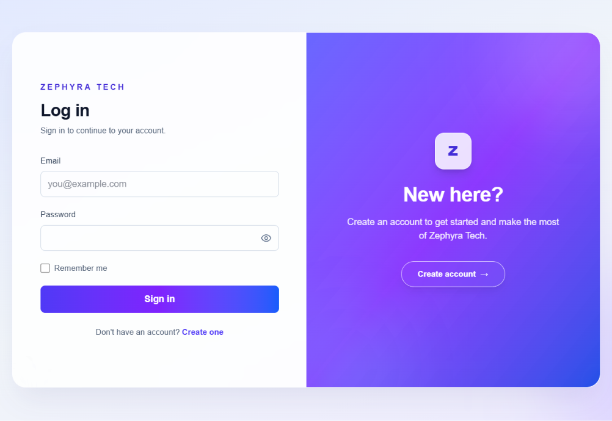

# Zephyra Tech Login Frontend

Next.js frontend for the Zephyra Tech login application. It provides user registration, login, JWT-based authentication, and a dashboard that loads the authenticated user's profile from the Spring Boot backend.

## Technology

- Next.js 16 (App Router)
- React 19
- TypeScript
- Tailwind CSS 4
- npm

## Features

- Responsive login and registration screens with alternating indigo–violet–blue gradient panels and a frosted-glass visual style.
- Register with an email address, password, and matching password confirmation. Passwords must be at least 8 characters; backend validation remains authoritative.
- Toggle visibility independently for the password and confirmation fields; login also has a password visibility toggle.
- Sign in and store the returned JWT in `sessionStorage` by default; “Remember me” keeps it in `localStorage` across browser sessions.
- Load the current user's profile on the protected dashboard, styled with the same glass and gradient treatment.
- Sign out by removing the stored JWT.
- Clear an expired/invalid JWT and redirect to login when the dashboard receives an unauthorized response.
- Display API errors on the registration, login, and dashboard screens.
- Use Zephyra Tech browser-tab metadata and a custom gradient favicon.

## Screenshots

For a README portfolio section, capture these screens at a consistent desktop viewport and add the image files under `screenshots/` in this repository:

| Suggested order | Screenshot file | What to show |
| --- | --- | --- |
| 1 | `screenshots/login.png` | Login form, gradient welcome panel, and “Remember me” |
| 2 | `screenshots/register.png` | Registration form with password confirmation and the reversed gradient panel |
| 3 | `screenshots/dashboard.png` | Single-card dashboard with profile details and sign-out button |

Once the images are added, embed them here with Markdown, for example:

```markdown

```

Use a test account for screenshots and avoid showing real passwords, production secrets, or personal account data.

## Routes

| Frontend route | Purpose |
| --- | --- |
| `/login` | Sign in with an existing account |
| `/register` | Create an account |
| `/dashboard` | View the authenticated user's profile and sign out |

The dashboard redirects visitors without a stored token to `/login`. The frontend sends the token as a Bearer token when requesting the profile.

The root route (`/`) redirects to `/login`.
The login and registration pages use a responsive split-panel layout with the indigo welcome panel on opposite sides. The dashboard uses a single glass-style card.

## Backend API

The frontend reads its API base URL from `NEXT_PUBLIC_API_BASE_URL` and expects the Spring Boot backend to expose these endpoints:

| Method | Endpoint | Access | Purpose |
| --- | --- | --- | --- |
| `POST` | `/api/auth/register` | Public | Register an account |
| `POST` | `/api/auth/login` | Public | Authenticate and return a JWT |
| `GET` | `/api/auth/me` | Bearer JWT | Return the authenticated user's ID and email |
| `GET` | `/api/health` | Public | Backend health check |

Registration and login requests use JSON:

```json
{
  "email": "person@example.com",
  "password": "your-password"
}
```

Login returns a JWT. The frontend accepts a token in a `token`, `jwt`, or `accessToken` response field (or as a plain-text response), saves it as `token` in `sessionStorage` unless “Remember me” is selected (then `localStorage`), and redirects to `/dashboard`.

The profile request includes this header:

```http
Authorization: Bearer <jwt>
```

The dashboard displays the JSON returned by `/api/auth/me`, for example:

```json
{
  "id": 1,
  "email": "person@example.com"
}
```

The backend must allow the frontend origin through CORS. For local development, the backend's default allowed origin is `http://localhost:3000`.

## Run locally

1. Install Node.js and npm.
2. Start the Spring Boot backend on port `8080`.
3. In the frontend repository root, create `.env.local`:

   ```dotenv
   NEXT_PUBLIC_API_BASE_URL=http://localhost:8080/api
   ```

   `.env.local` is ignored by Git. Set the variable in the hosting provider's environment configuration when deploying.
4. Install dependencies and start the development server:

   ```powershell
   npm install
   npm run dev
   ```

5. Open [http://localhost:3000](http://localhost:3000).

## Checks

Create an optimized production build:

```powershell
npm run build
```

Run ESLint:

```powershell
npm run lint
```

Start the production build locally:

```powershell
npm run start
```

## Deployment notes

This repository contains the frontend only; the Spring Boot API and PostgreSQL database are deployed separately.

To deploy the frontend to Vercel:

1. Push this repository to GitHub and import it into Vercel.
2. Configure `NEXT_PUBLIC_API_BASE_URL` in the Vercel project environment variables with the deployed backend API base URL, for example `https://your-backend.example.com/api`.
3. Redeploy after setting or changing the environment variable. `NEXT_PUBLIC_` variables are included in the browser bundle at build time and are not secret.
4. Configure the backend's `CORS_ALLOWED_ORIGINS` to include the exact deployed frontend origin, for example `https://your-frontend.vercel.app`.
5. Verify the backend health endpoint and test registration, login, profile loading, and sign out.

Do not put credentials, JWT signing keys, or other secrets in `NEXT_PUBLIC_` variables or commit them to source control.
The registration form requires a password of at least 8 characters to match backend validation. Frontend checks improve usability only; the backend remains authoritative. The current assessment implementation stores JWTs in browser storage, where JavaScript can access them. For production, consider an `HttpOnly`, `Secure`, `SameSite` cookie design with appropriate CSRF protections.
Git ignore rules do not automatically exclude files from ZIP archives. Exclude `.env.local`, `node_modules`, and generated build output before sharing or publishing an archive.