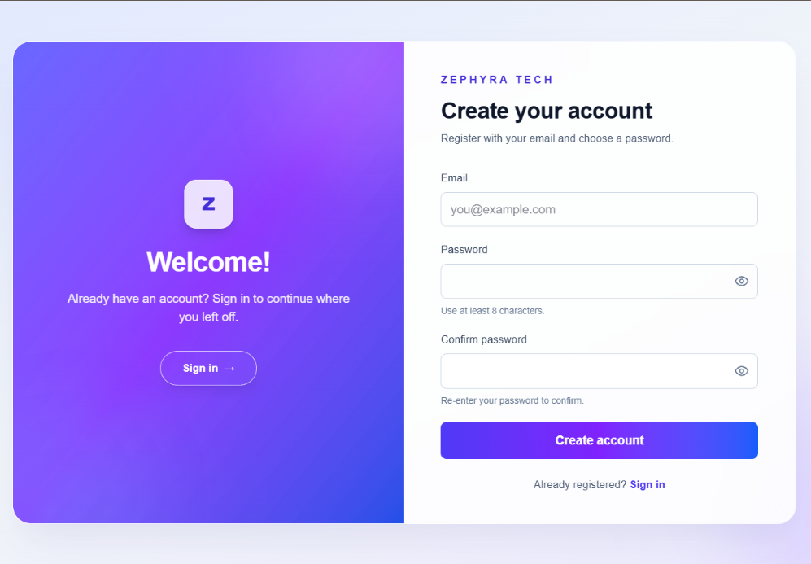
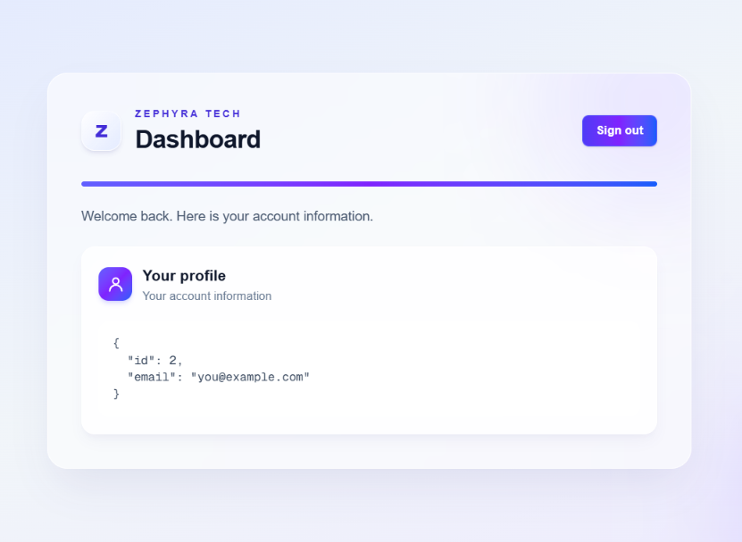

# Zephyra Tech Login — Frontend

This repository contains the browser-based frontend for Zephyra Tech Login, a responsive account registration and authentication application. It is built with Next.js and TypeScript and connects to the separately maintained Spring Boot API.

## Live application

- **Frontend:** [https://zephyratech-login-frontend.vercel.app](https://zephyratech-login-frontend.vercel.app)
- **Frontend source:** [zephyratech-login-frontend](https://github.com/Sithumini-Anuhansi/zephyratech-login-frontend)
- **Backend source:** [zephyratech-login-backend](https://github.com/Sithumini-Anuhansi/zephyratech-login-backend)
- **Backend API:** [https://zephyratech-login-backend.onrender.com](https://zephyratech-login-backend.onrender.com)
- **API health check:** [https://zephyratech-login-backend.onrender.com/api/health](https://zephyratech-login-backend.onrender.com/api/health)

## Demo account

The following disposable demo account is registered in the live application:

- **Email:** `zephyra.demo@example.com`
- **Password:** `Zephyra!Demo-Bluebird`

This account is for demonstration only. Do not use it for personal or sensitive information, and do not reuse its password on another service.

## Features

- Responsive registration and login screens.
- Password confirmation and password-visibility controls.
- JWT-based sign-in with a “Remember me” option.
- Protected dashboard displaying the authenticated user's profile.
- Sign-out and handling for expired or invalid sessions.
- API error messages on registration, login, and dashboard screens.

## Routes

| Route | Description |
| --- | --- |
| `/login` | Sign in to an existing account |
| `/register` | Create an account |
| `/dashboard` | View the signed-in user's profile |
| `/` | Redirects to `/login` |

## Frontend and API

The frontend reads its API base URL from `NEXT_PUBLIC_API_BASE_URL`. The deployed frontend uses the backend API base `https://zephyratech-login-backend.onrender.com/api`.

| Method | API route | Purpose |
| --- | --- | --- |
| `POST` | `/api/auth/register` | Create an account and receive a JWT |
| `POST` | `/api/auth/login` | Authenticate and receive a JWT |
| `GET` | `/api/auth/me` | Retrieve the authenticated user's profile |
| `GET` | `/api/health` | Check backend service health |

The frontend stores the JWT in browser storage and sends it as a Bearer token when requesting the protected profile. The backend controls authentication, validation, and data persistence.

## Screenshots

### Login

### Registration

### Dashboard

The screenshots use demo data only. Do not include private credentials, production secrets, or personal account information in replacement screenshots.

## Technology

- Next.js 16 App Router
- React 19
- TypeScript
- Tailwind CSS 4
- npm
